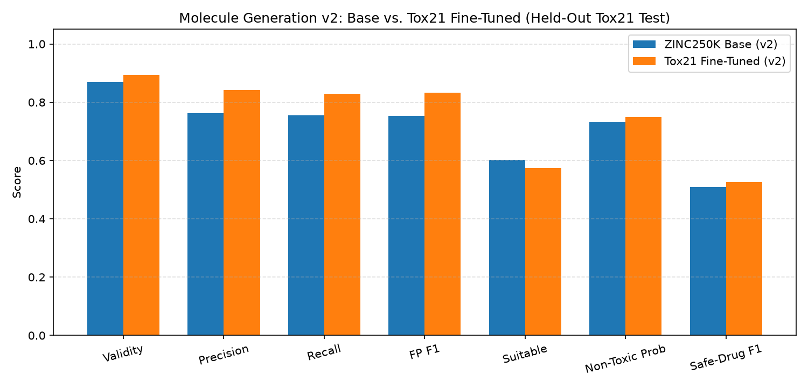

# Drug Molecule Generation v2 (`PropFPToSMILES`: ZINC250K → Tox21)

End-to-end machine learning pipeline for **property- and safety-conditioned de novo molecule generation** pre-trained on the **full ZINC250K dataset** (`logP`, `QED`, `SAS`) and fine-tuned on **verified non-toxic Tox21** molecules, managed with `uv` and PyTorch (CUDA + AMP).

---

## Model Architecture (`PropFPToSMILES`)

An autoregressive causal Transformer decoder conditioned on **two prefix tokens** prepended before `<BOS>`:
1. **Fingerprint Prefix**: 2048-bit Morgan fingerprint (radius 2) → `Linear(2048, 256) + GELU + LayerNorm`
2. **Property Prefix**: Z-score normalized `[logP, QED, SAS]` → `Linear(3, 256) + GELU + LayerNorm`

| Component | Configuration |
| :--- | :--- |
| **Input Conditioning** | 2048-bit Morgan Fingerprint (radius 2) + 3-D Property Vector `[logP, QED, SAS]` |
| **Tokenizer / Vocab** | Atom-wise SMILES regex tokenizer (`57` tokens, `MAX_LEN = 92`) |
| **Transformer Backbone** | 4-layer causal `TransformerEncoder` (`d_model=256`, `nhead=8`, `dim_feedforward=1024`, `dropout=0.1`, Pre-LN) |
| **Total Parameters** | `3,738,937` (~14.29 MB checkpoint) |
| **Toxicity Scorer** | `Tox21BinarySafetyClassifier` MLP (`2048 → 512 → 128 → 1`) trained on binary aggregated Tox21 assays (`sum >= 1` → toxic) |
| **Compute Environment** | NVIDIA GeForce RTX 4050 Laptop GPU (5.69 GiB VRAM), PyTorch `2.15.0+cu132`, AMP (`float16`) |

---

## Pipeline Stages ([`src/molecule_generation.ipynb`](src/molecule_generation.ipynb))

1. **Data Gathering & Config** — Centralizes all dataset sizes (`zinc_train_limit=None`, `zinc_val_limit=None`), hyperparameters, and thresholds in `CONFIG`; validates CUDA; loads full ZINC250K (`yairschiff/zinc250k`) and Tox21 (`tox21.csv.gz`).
2. **Data Preprocessing (ZINC250K)** — Uses the full 224,568 train / 12,443 val / 12,444 test splits, builds the 57-token SMILES vocabulary, fits `[logP, QED, SAS]` normalization stats, and computes 2048-bit Morgan fingerprints.
3. **Train Model (via ZINC250K)** — Trains `PropFPToSMILES` for 12 epochs (`AdamW`, `lr=1e-3`, `OneCycleLR`, `batch_size=256`, AMP, Peak VRAM `1.04 GiB`), restoring the best validation checkpoint.
4. **Evaluate Model (Base ZINC250K)** — Evaluates `zinc_model` on held-out `zinc_test_loader` and prints the standardized 11-metric evaluation box.
5. **Extract Model as a File** — Saves self-contained checkpoint `models/zinc250k_prop_fp2smiles_v2.pt` (weights, vocab, `prop_mean`/`prop_std`, `CONFIG`, metrics) with round-trip load verification.
6. **Data Preprocessing (Tox21)** — Collapses all 12 toxicity assays into a single binary label (`toxic_sum >= 1` → toxic, `0` → non-toxic), trains `Tox21BinarySafetyClassifier` (`models/tox21_safety_classifier_v2.pt`), and creates 80/10/10 non-toxic fine-tuning splits with RDKit `[logP, QED, SAS]`.
7. **Fine-Tuning (Tox21 Non-Toxic Data)** — Loads `models/zinc250k_prop_fp2smiles_v2.pt` into `tox_model`, fine-tunes exclusively on verified non-toxic Tox21 molecules for 10 epochs (`AdamW`, `lr=2e-4`, `CosineAnnealingLR`), and saves `models/tox21_prop_fp2smiles_v2.pt`.
8. **Evaluate Model (Fine-Tuned Tox21)** — Evaluates `tox_model` on held-out `tox_test_loader` with all 11 metrics including `Non-Toxic Prob`.
9. **Calculate F1 & Version Comparison** — Compares Base v2 vs. Fine-Tuned v2 on `tox_test_loader` using **Fingerprint F1** and **Safe-Drug F1**, saving `metrics/v2_f1_leaderboard.json` and `metrics/v2_f1_comparison.png`.

---

## Dataset Splits

| Dataset | Raw Size | Used / Filtered | Train | Validation | Test |
| :--- | ---: | ---: | ---: | ---: | ---: |
| **ZINC250K (Full)** | 249,455 | 249,455 | 224,568 | 12,443 | 12,444 |
| **Tox21 (Non-Toxic)** | 7,831 | 4,697 | 3,757 | 470 | 470 |

---

## Results (Held-Out Tox21 Test Set)

| Metric | v1 Fine-Tuned | Base ZINC250K (v2) | **Fine-Tuned Tox21 (v2)** |
| :--- | :---: | :---: | :---: |
| **1. Validity** | 78.12% | 87.02% | **89.36%** |
| **2. Uniqueness** | 100.00% | 99.02% | **99.29%** |
| **3. Precision (FP)** | 0.7202 | 0.7627 | **0.8425** |
| **4. Recall (FP)** | 0.7013 | 0.7543 | **0.8297** |
| **5. F1 (FP F1)** | 0.7046 | 0.7539 | **0.8329** |
| **6. LogP** | 2.1305 | 2.0683 | **2.2044** |
| **7. QED** | 0.5272 | 0.5643 | **0.5527** |
| **8. SAS** | 2.4875 | 2.5602 | **2.5333** |
| **9. Suitable** (`-0.4<=logP<=5.0`, `QED>=0.5`, `SAS<=4.5`) | 58.00% | 60.15% | **57.38%** |
| **10. Sample SMILES** | `CN(C)/C=C/c1ccc(Br)cc1` | `CC(C)CCCCOC(=O)c1ccccc1-c1ccccc1C(C)C` | `CC(C)CCCCCCOC(=O)c1ccccc1C(=O)OCCCCCCC(C)C` |
| **11. Non-Toxic Prob** (`1 - P(toxic)`) | — | 0.7323 | **0.7488** |
| **Safe-Drug F1** | — | 0.5083 | **0.5250** |



---

## Quick Start

```bash
# Sync dependencies
uv sync

# Launch interactive JupyterLab
uv run jupyter lab

# Execute full pipeline from CLI
uv run jupyter nbconvert --to notebook --execute --inplace --ExecutePreprocessor.timeout=3600 src/molecule_generation.ipynb
```
